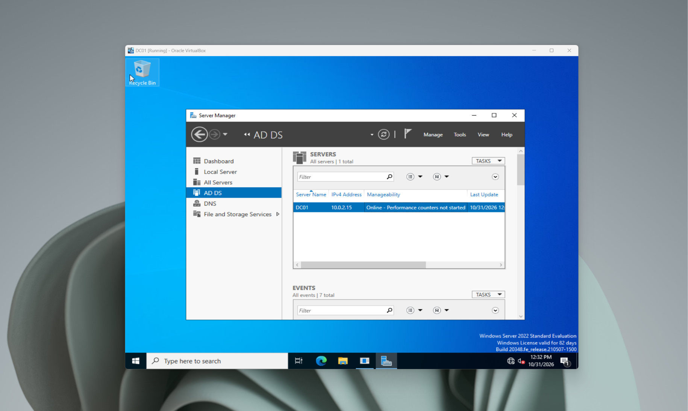
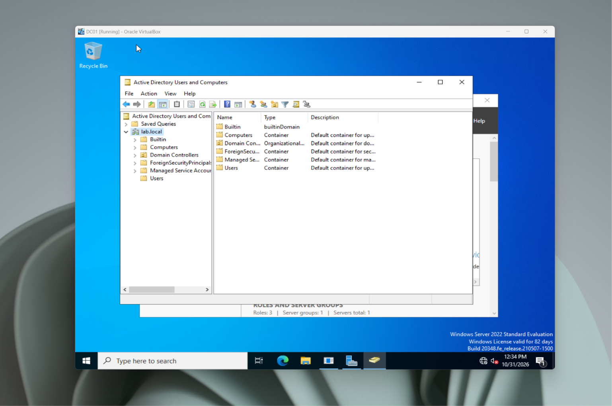
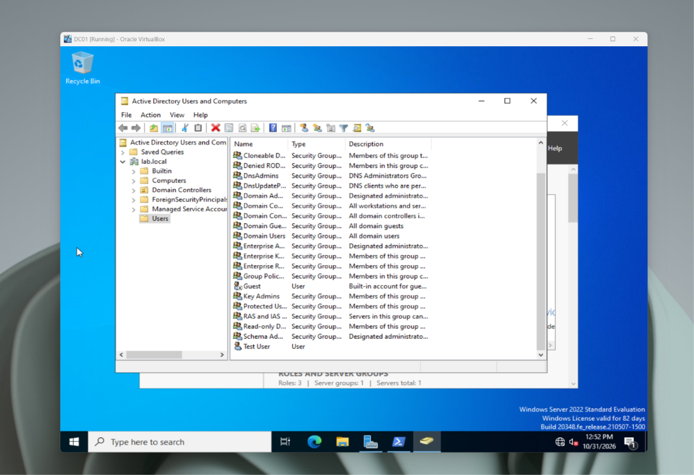
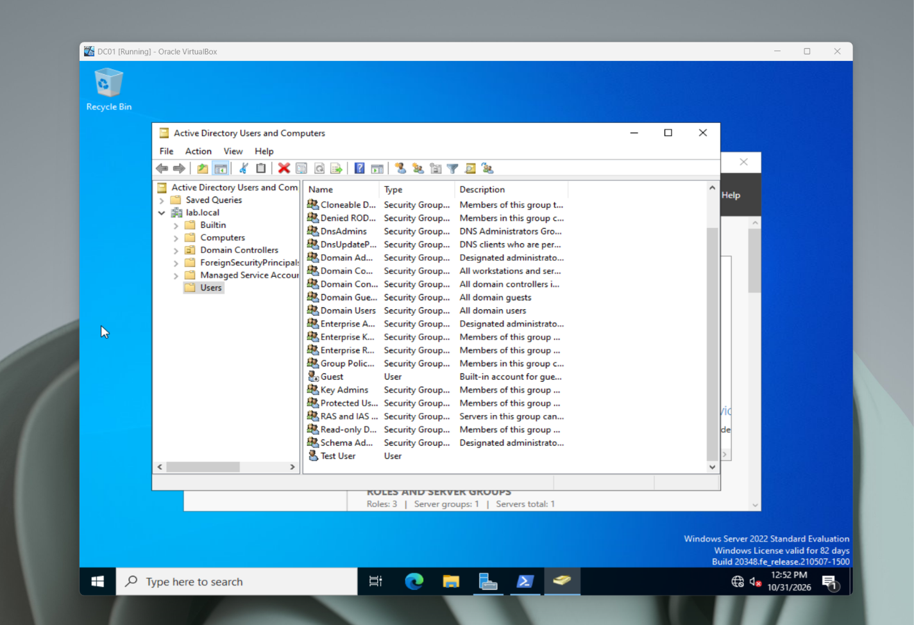
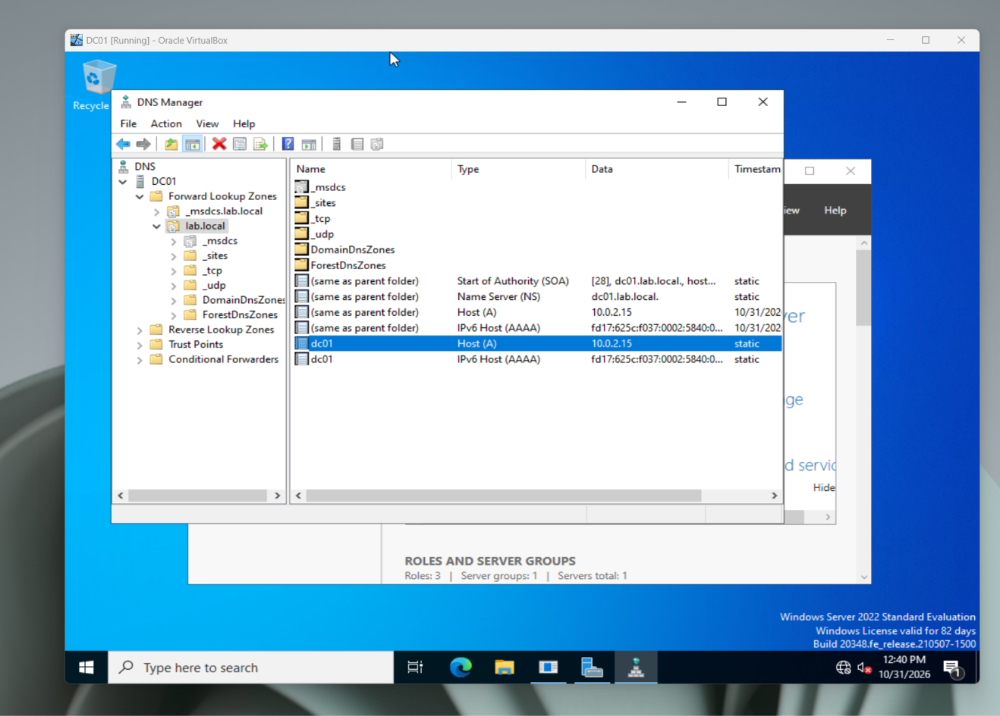
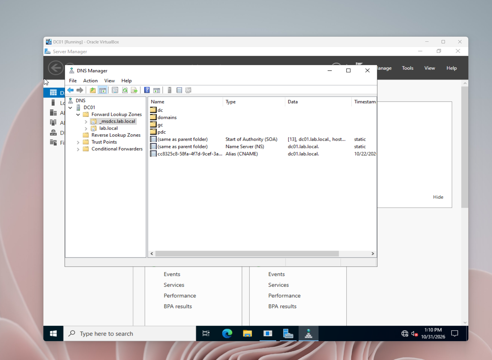
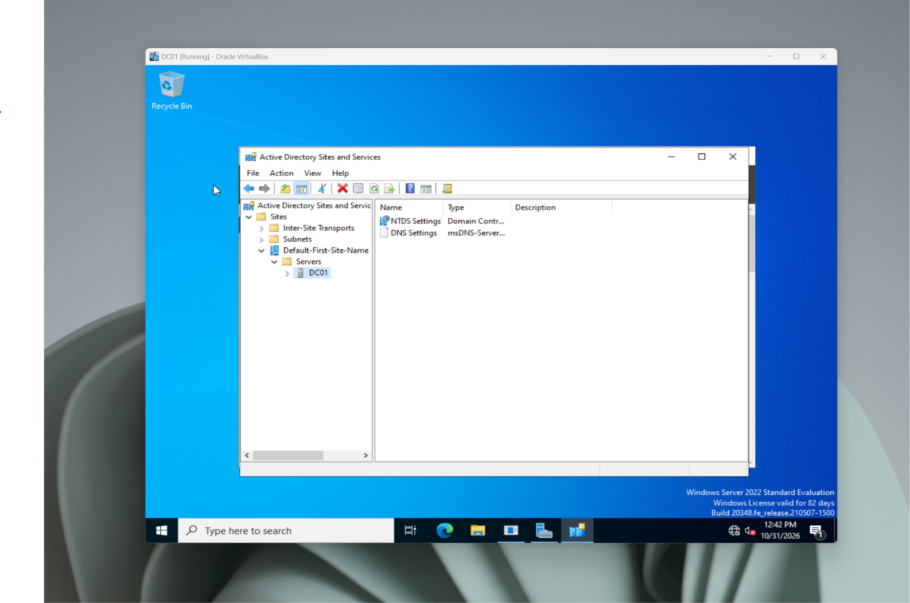
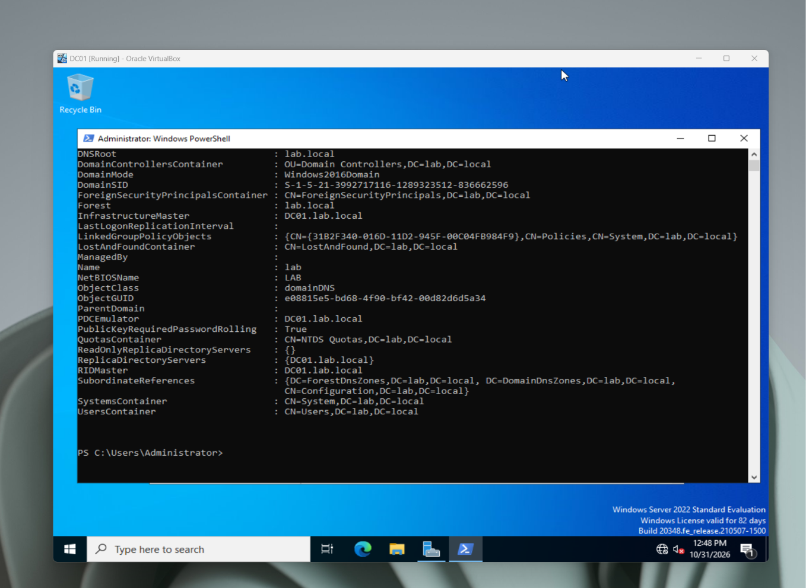

# Active-directory-home-lab
Windows Server 2022 — Active Directory Home Lab

Overview

A hands-on IT support lab built using Oracle VirtualBox and Windows Server 2022 to practice Active Directory administration and common help desk tasks.

Lab Environment

* Virtualization: Oracle VirtualBox
* Operating System: Windows Server 2022 Desktop Experience
* Domain Controller: DC01
* Active Directory Domain: lab.local

Tasks Completed

* Installed and configured Windows Server 2022.
* Installed Active Directory Domain Services (AD DS) and DNS.
* Promoted DC01 to a domain controller.
* Created the lab.local domain.
* Created a test user account in Active Directory.
* Reset a user’s password.
* Created a Help Desk security group.
* Added a user to the Help Desk group.
* Practiced disabling and re-enabling a user account.

Skills Practiced

* Windows Server administration fundamentals
* Active Directory user management
* Password reset procedures
* Security group membership
* Basic account administration
* Troubleshooting and documenting IT tasks

## Active Directory Homelab Screenshots

### 1. Server Manager

### 2. Active Directory Users and Computers

### 3. Domain Users

### 4. Security Groups

### 5. DNS Configuration

### 6. MSDCS DNS

### 7. Sites and Services

### 8. Domain Verification

Screenshots documenting the lab setup and completed tasks will be added here. All screenshots will exclude passwords and sensitive information.

Future Improvements

* Practice additional account troubleshooting scenarios.
* Explore Group Policy.
* Document help desk tickets based on lab exercises.
* Build additional networking and infrastructure projects.

Disclaimer

This is a personal educational lab running in a virtual environment. It is not a production network.
